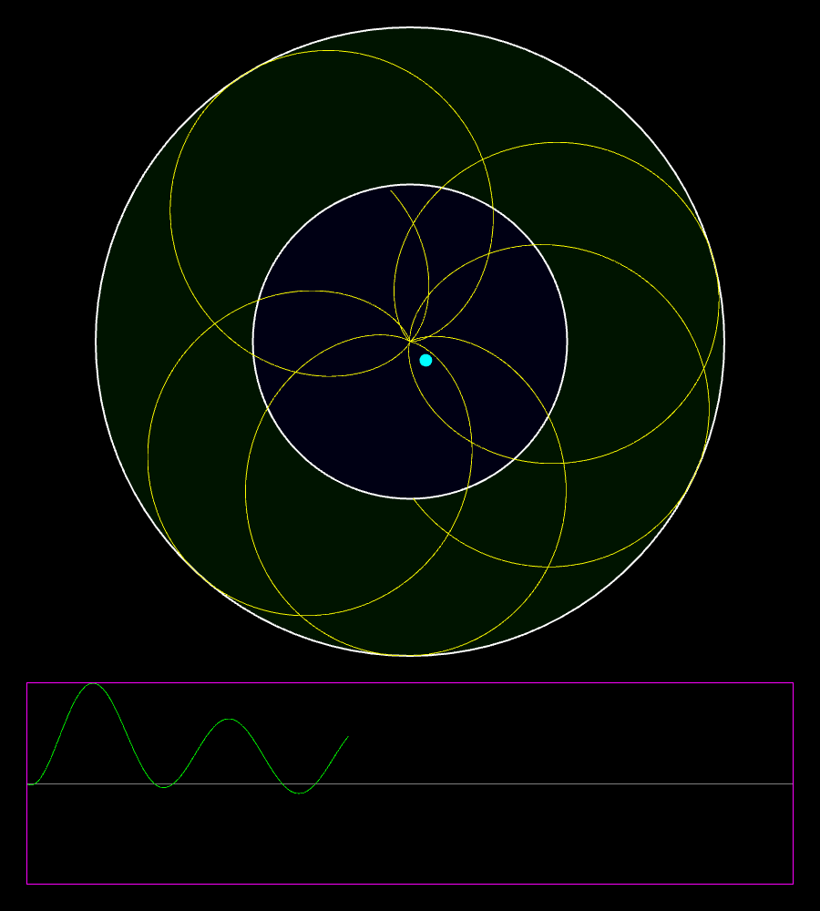
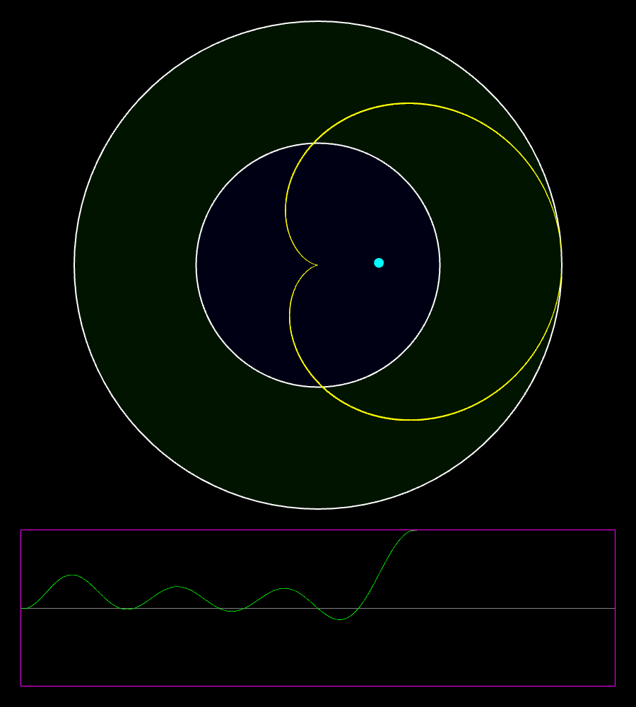
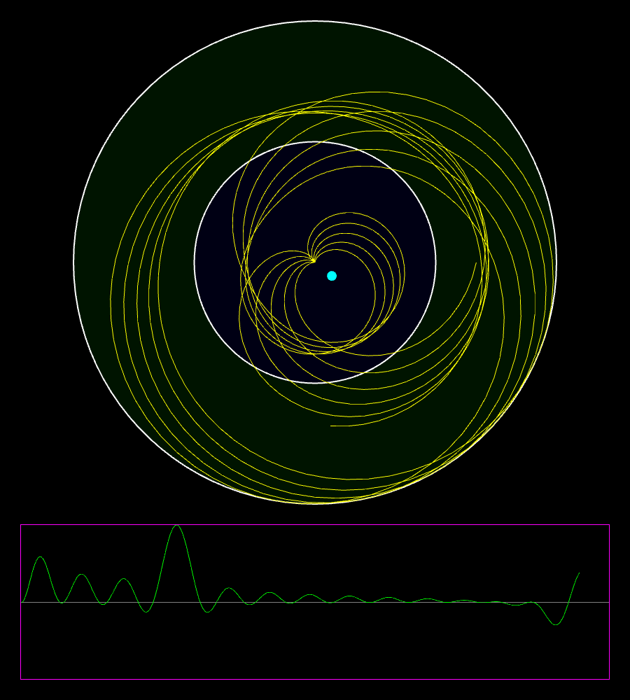

# Graphical Fourier Analysis

An interactive visualization of the Fourier transform. You type in a function, it gets wound around a circle at a slowly rising frequency, and the center of mass of the wound-up graph is tracked over time. When the winding frequency matches a frequency in the signal, the center of mass moves away from the middle, and that shows up as a peak in the plot at the bottom.

I wrote this in high school after watching 3Blue1Brown's video
[**But what is the Fourier Transform? A visual introduction.**](https://www.youtube.com/watch?v=spUNpyF58BY).
It recreates the "winding machine" from that video, with my own small math expression parser.

| Frequency doesn't match | Frequency matches | Two frequencies |
| :---: | :---: | :---: |
|  |  |  |
| `sin(pi x)`: the graph is spread evenly, so the center of mass stays near the middle. | `sin(pi x)` at 0.5 windings per unit: the peaks line up on one side and the center of mass moves out. | `sin(pi x) + 0.5cos(3pi x)`: one peak for each frequency in the signal. |

## What you see

- **Circle (top):** the function `f(x)`, sampled for `x` from 0 to 10, wound around the origin. The signal is scaled into the range [0, 1]: the inner (blue) circle is `f(x) = 0` and the outer edge is the largest absolute value of `f(x)`.
- **Cyan dot:** the center of mass of the wound-up graph.
- **Plot (bottom):** the horizontal position of the center of mass as the winding frequency goes up. This is the "almost Fourier transform" from the video.
- **Window title:** the current winding frequency, in windings per unit of `x`.

## Building

You need a C++17 compiler, CMake ≥ 3.28 and git. [SFML 3](https://www.sfml-dev.org/) is downloaded and built automatically with CMake's `FetchContent`, so you don't need to install it yourself.

On Linux, SFML needs a few system development packages:

```bash
# Debian / Ubuntu
sudo apt install libxrandr-dev libxcursor-dev libxi-dev libudev-dev libgl1-mesa-dev libegl1-mesa-dev
```

```bash
# Arch Linux
sudo pacman -S libxrandr libxcursor libxi systemd-libs mesa
```

Then build:

```bash
cmake -S . -B build -DCMAKE_BUILD_TYPE=Release
```

```bash
cmake --build build
```

The first configure takes a while because it clones and builds SFML.

## Usage

Pass the function as an argument:

```bash
./build/GraphicalFourierAnalysis "sin(pi x) + 0.5cos(3pi x)"
```

If you start it without arguments, it asks for the function on the command line.

### Controls

| Key | Action |
| --- | --- |
| `Space` | Pause / resume |
| `Up` / `Down` | Double / halve the speed |
| `R` | Restart from the lowest frequency |
| `Esc` | Quit |

### Expression syntax

| Feature | Example |
| --- | --- |
| Variable (any single letter, usually `x`) | `x` |
| Arithmetic | `+ - * / ^`, e.g. `2*x^2 - 1` |
| Implicit multiplication | `2x`, `3pi x`, `2sin(x)` |
| Brackets and absolute value | `(x + 1)`, `\|x - 5\|` |
| Constants | `pi`, `e`, `i` |
| Functions | `sin cos tan asin acos atan sqrt log real imag` |
| Two-argument functions | `pow(base, exp)`, `plog(base, value)` |

Some inputs to try:

```bash
./build/GraphicalFourierAnalysis "sin(2pi x)"
```

```bash
./build/GraphicalFourierAnalysis "cos(2pi x) + cos(2pi 1.5x)"
```

```bash
./build/GraphicalFourierAnalysis "|sin(pi x)|"
```

A frequency of `k` cycles per unit of `x` (for example `sin(2pi k x)`) gives a peak at `k` windings per unit in the window title.

## Project structure

```
main.cpp         window, layout and main loop
FT/              winds the sampled signal around the circle and computes the center of mass
Math/            lexer + recursive-descent parser that compiles an expression into a small stack-based bytecode
Plot/            SFML drawables for the circle view and the scrolling plot
```
